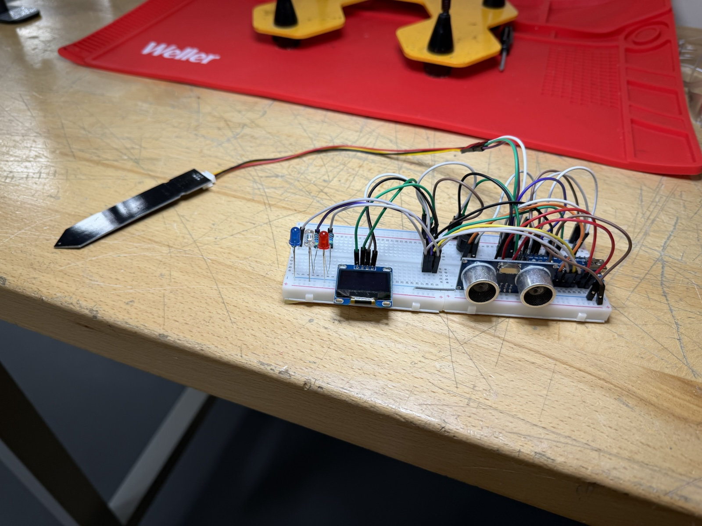
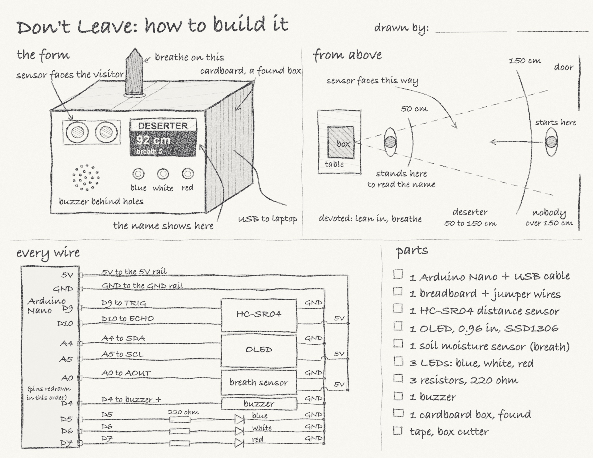
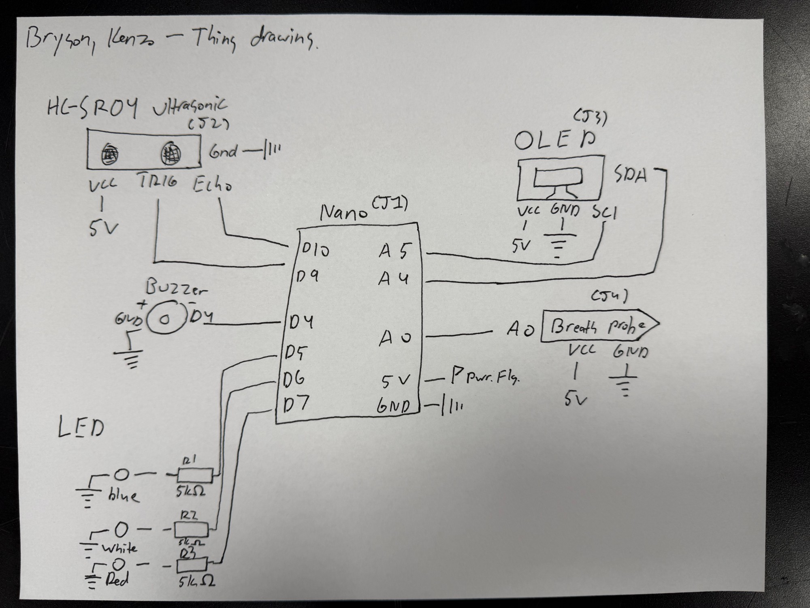

# Don't Leave

Kenzo Liddle and Bryson England · Computer Coding Studio, fall 2026 · v1.0

An Arduino Nano watches how close you stand and whether you breathe on it, then calls you **devoted**, **deserter** or **nobody**, and acts on the name.

## The charter

### It sees

| Reading | What it reads |
|---|---|
| `cm` | nobody: 213.9, 214.8, 213.2 (empty table, Nov 2) · at the 50 cm edge: 49, 48, 46 · leaning in: 10, 12, 14 · no echo prints `ping 0.0`, and after 5 in a row `cm` reads 400 |
| `breath` | nobody: 4–7 idle noise (Oct 29), −1 to 0 (Nov 10, `bench/DIAGNOSTICS.md`) · a light breath: 19–23 · a hard breath: 30+ |

### It calls you

| Name | Rule | Hold |
|---|---|---|
| devoted | `breath` over 9 **and** `cm` under 12 | breath has to stay up for 3 s (it may dip 3 between breaths); then it keeps counting for 5 s after you stop |
| deserter | `cm` 50 to 150 (red), or closer than 50 with no breath (white) | 2 s before red; once red, it stays red until you come under 45 cm |
| nobody | `cm` over 150 | 5 s |

Rows are checked top to bottom. Until a new name has held for its whole hold, it keeps the name it has.

### It does

| Name | Action |
|---|---|
| devoted | blue LED (D5) steady, buzzer silent, the OLED says DEVOTED |
| deserter, 50 to 150 cm | red LED (D7) flashes, a two-tone siren on D4 speeds up, the OLED says DESERTER. The siren gives up after 60 s; the red keeps flashing |
| deserter, closer than 50 cm with no breath | white LED (D6), a short beep every 2 s, the OLED says DESERTER |
| nobody | every LED off, silent, the OLED says NOBODY |

The name fills the middle of the screen, big enough to read from 1 m. Under it, small, the screen shows the distance and the breath number. Every reading also goes out over USB as a word and a number (`cm 42.5 ping 42.5 moisture 481 breath 0 name deserter`).

### For them / To them

| Name | For them | To them |
|---|---|---|
| devoted | it goes calm and quiet the moment you give it your breath | it only counts breath, so someone with asthma or in a mask can never be devoted |
| deserter | it tells you, out loud, that it noticed you drifting | it calls stepping back to talk to a friend desertion, and sirens at you for it |
| nobody | it rests instead of shouting at an empty room | it can't tell someone who left from someone standing quietly just past 150 cm |

### Who it names wrongly

- Anyone who can't lean in under 12 cm and breathe on the probe (asthma, a mask, a wheelchair that can't get that close) can never be devoted. It calls them a deserter.
- Someone who steps back to talk to a friend is a deserter.
- Someone standing still just past 150 cm is nobody.
- With two people, it only hears the nearer one (#56).
- Soft, puffy clothing can swallow the echo. We haven't tested what it calls someone in a puffy jacket yet (#35).

### The rest

- **It refuses:** to keep score of how long you stayed or how often you left. Nothing is saved or sent.
- **Set aside:** Bryson's Don't Leave Me, which sirened at an empty room.
- **Sits next to:** LAUREN (Lauren Lee McCarthy, 2017), and pushes back: LAUREN watched to serve the people in the house; this watches to make you serve it.
- **The tension:** to see the whole piece you have to step back, and stepping back makes you a deserter.

## State Table

Rows are checked top to bottom, and the first one true for its whole hold wins.

| Name | Readings at the edge | LINE | GAP | Hold | Visitor learns it by | Piece does | For them / To them | Owner |
|---|---|---|---|---|---|---|---|---|
| devoted | 24, 25, 27 breath, under 12 cm | 9 | 3 | 3 s | the word DEVOTED on the OLED, with the blue LED | D5 blue steady; buzzer silent; OLED prints DEVOTED | For them: it goes calm and quiet the moment you give it your breath. To them: it only counts breath, so someone with asthma or in a mask can never be devoted. | @BrysonAI30 |
| deserter | 49, 48, 46 cm | 50 | 5 | 2 s | the word DESERTER on the OLED, with the red LED flashing and the siren | D7 red flashes; D4 siren speeds up; OLED prints DESERTER. Closer than 50 cm with no breath: D6 white and a beep every 2 s | For them: it tells you, out loud, that it noticed you drifting. To them: it calls stepping back to talk to a friend desertion, and sirens at you for it. | @kliddle29 |
| nobody | 213.9, 214.8, 213.2 cm (empty table, Nov 2, before the rewire) | 150 | 10 (not in the sketch yet, #42) | 5 s | the word NOBODY on the OLED, every light off, silence | D5, D6, D7 off; buzzer silent; OLED prints NOBODY | For them: it rests instead of shouting at an empty room. To them: it can't tell someone who left from someone standing quietly just past 150 cm. | @kliddle29 @BrysonAI30 |

## The build

An Arduino Nano with an HC-SR04 ultrasonic sensor, a capacitive moisture sensor used as a breath probe, one 0.96 in OLED, a buzzer and three LEDs. The sketch is `bench/sensor_prototype/sensor_prototype.ino`.

| The piece, Nov 16 | The design | The wiring, by hand |
|---|---|---|
|  |  |  |

### Wiring

| Part | Pin | Nano |
|---|---|---|
| HC-SR04 | VCC / GND | 5V / GND |
| | TRIG | D9 |
| | ECHO | D10 |
| OLED (SSD1306, I2C) | VCC / GND | 5V / GND |
| | SDA | A4 |
| | SCL | A5 |
| Breath probe (capacitive moisture v2.0) | VCC / GND | **5V** / GND (it reads 0 on 3.3 V) |
| | AOUT | A0 |
| Buzzer | + / − | D4 / GND |
| Blue LED | long leg through a resistor | D5 |
| White LED | long leg through a resistor | D6 |
| Red LED | long leg through a resistor | D7 |
| LEDs | short legs | GND |

Keep RX0, TX1 and RST empty: a wire there stops uploads. The hand-drawn version is `design-wiring.jpg` (its buzzer + and − are swapped; the table is right).

## How to run it

1. Plug the Nano into a power bank or a USB wall charger. The sketch starts on its own; no laptop, no Serial Monitor.
2. Keep away from the breath probe while the screen says "hands off..." (about a second): it is learning the room.
3. Leave 150 cm clear in front of the sensor, and let people walk up.

### Uploading the sketch

1. Open `bench/sensor_prototype/sensor_prototype.ino` in the Arduino IDE. It needs the **U8g2** library.
2. **Tools → Board → Arduino Nano**, **Tools → Processor → ATmega328P (Old Bootloader)**, and pick the Nano's port. Upload.
3. To watch the numbers, open the Serial Monitor at **9600**. Close it again before running the piece or opening `bench.html`: only one program can hold the port.

### In the browser (optional)

`bench.html` reads the same USB line and shows the same three names. Open it on localhost in **Chrome**, click **Connect the Arduino**, pick the board, and press **D** to see the raw line. The page saves nothing. The template's camera files (`index.html`, `sense.js`, `table.js`) are still in the repo, but Don't Leave doesn't use them.

## Troubleshooting

Problems we actually hit, and what fixed them.

| What you see | Why | Fix |
|---|---|---|
| Upload stops at "attempt 1 of 10: not in sync" | Wrong bootloader setting, or a wire on RX0 / TX1 / RST | Tools → Processor → **ATmega328P (Old Bootloader)**; unplug the parts and try again; replug the USB cable if it hangs |
| Upload succeeds but nothing changed | The IDE uploaded another copy of the sketch | Open the sketch from this repo; check the top comment matches |
| Serial Monitor shows garbage | Wrong speed | Set it to **9600** |
| Screen blank, the whole Nano frozen | A loose OLED wire stalled the I2C bus | Reseat SDA → A4 and SCL → A5; the sketch's Wire timeout keeps the rest running |
| `moisture` reads 0 | The probe is on 3.3 V | Move its VCC to 5V |
| `cm` stuck at one small number (5.6, 8.4) | Something in front of the sensor's cone | Clear 30 cm in front and raise the sensor off the table (#30) |
| Most pings read `ping 0.0` | Loose TRIG / ECHO / power wire | Push all four HC-SR04 wires in firmly |
| White LED always on | Something under 12 cm, no breath | Same as above: clear the sensor's view (#53) |
| Breath never reaches the line | Line too high for a real breath | Breathe from about 3 cm; the line is 9 (see the break log) |

## Lineage

- **LAUREN** (Lauren Lee McCarthy, 2017): an artist acts as a live smart speaker in a stranger's house, watching through cameras to serve them. Ours turns that around: it watches you to make you serve it. [See the project](https://get-lauren.net/LAUREN)

## Break log

What broke, and what we changed because of it. Threshold changes go here too.

| Date | Commit | What broke | What changed |
|---|---|---|---|
| 2026-10-29 | `6496e7c` | The page read nothing: the sketch was at 9600, the page at 115200 | `bench/sense-serial.js` reads at 9600 |
| 2026-10-29 | `52a1141` | A loose OLED wire froze the whole Nano; the moisture sensor read 0 on 3.3 V | Added a Wire timeout; moved the moisture sensor to 5V; added breath, LEDs, buzzer and a second screen |
| 2026-10-29 | `1b38a15` | Too easy to stay quiet from across the desk | Breath line 10 → 30; blue under 12 cm, white 12–50, red past 50 |
| 2026-10-29 | `220d29f` | It stayed quiet from one sensor alone | Quiet now needs breath **and** under 12 cm |
| 2026-10-29 | `eeca326` | The breath screen stayed black on D2/D3 | Breath screen to A1/A2, distance screen to D11/D12 (which made it slow) |
| 2026-10-30 | `e7d0cb1` | A breath of 30 was too hard to reach | Breath line 30 → 25 |
| 2026-11-02 | `5a58b36` | A commit on protected `main` couldn't be pushed and included `.DS_Store` | Moved the edits to a branch; added `.gitignore` |
| 2026-11-03 | `50998a2` | Two software-I2C screens slowed the Nano to about 1 reading a second | One OLED back on A4/A5 with distance and breath together |
| 2026-11-06 | `e1fc065` | The distance jumped: up to 90% of pings missed and counted as 400 cm | Misses ignored until 5 in a row, median of 3 drops spikes; rewired the HC-SR04 |
| 2026-11-06 | `6bd9713` | The sketch still used the old four levels, not the charter's names | Rewrote it around devoted / deserter / nobody |
| 2026-11-06 | `895784d` | That screen went blank most of the time; breath 25 was too hard to reach | Brought back the one-OLED screen; breath line 25 → 18 |
| 2026-11-06 | `1d2d7ff` | The screen said CHILL / WARN, not the charter's names, and nobody sirened | Badge shows DEVOTED / DESERTER / NOBODY; nobody is quiet; only red flashes during the siren |
| 2026-11-16 | `72a0132` | Swaying at the 50 cm line dropped the siren back to the white beep (found testing `updateLevel()` on a laptop) | Deserter GAP of 5: once red, it stays red until under 45 cm |
| 2026-11-17 | `d27d4ae` | The name was about 1.5 mm tall in the top strip; a deserter at 50 to 150 cm couldn't read it | The name is the big text now (DESERTER fills 120 of 128 px); distance and breath go small along the bottom |
| 2026-11-23 | `0e410a3` | Challenge: halve your line | Devoted's breath line 18 → 9; still needs under 12 cm and 3 s |

## Credits

- **Kenzo Liddle** (@kliddle29): the `near` signal and the **deserter** name; the charter's first draft and `design.jpg`
- **Bryson England** (@BrysonAI30): the `present` signal and the **devoted** name; the breath probe, OLED and LED wiring
- **Both:** the **nobody** name, the State Table and the hand-drawn `design-wiring.jpg`
- Started from the class's `sensor-layer-starter` template; the OLED sketch began as its `oled_demo.ino`
- Repo: https://github.com/kliddle29/sensor-project
